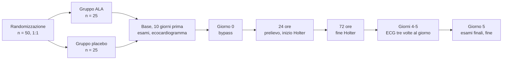

# Acido alfa-lipoico e fibrillazione atriale dopo bypass: protocollo di studio

> Scheda di lettura del protocollo «Effect of alpha-lipoic acid on atrial fibrillation and biomarkers of myocardial injury in patients undergoing coronary artery bypass surgery», *Trials* 2026;27:662, doi:10.1186/s13063-026-09959-y. **È un protocollo: non contiene risultati.** Sintesi con parole proprie, per studio.

---

## 📌 Che cosa dice il protocollo

Studio randomizzato, doppio cieco, controllato con placebo, su 50 pazienti da sottoporre a bypass aortocoronarico con circolazione extracorporea. Gruppo ALA (1200 mg al giorno) contro gruppo placebo, per 15 giorni (10 prima e 5 dopo l'intervento). Esiti principali: CK-MB a 5 giorni. Esiti secondari: fibrillazione atriale postoperatoria (POAF) con Holter e ECG, troponina I, degenza.

---

## 🗓️ Il calendario

---

## 🩺 Che cosa interessa all'infermiere

| Tema | Che cosa dice il protocollo |
| --- | --- |
| Definizione di POAF | Assenza di onde P distinte, QRS irregolari per più di 30 secondi |
| Monitoraggio | Holter a 12 derivazioni per 72 ore; ECG a 12 derivazioni tre volte al giorno nei giorni 4-5 |
| Marcatori | CK-MB e troponina I, con elettroliti e blood count |
| Somministrazione | Capsule alle 6 del mattino e alle 6 di sera, con registrazione nella cartella |

---

## ⚠️ Limiti da ricordare

- Nessun risultato: non è ancora noto se l'acido alfa-lipoico riduca la fibrillazione atriale.
- Studio monocentrico con 50 pazienti: il calcolo della dimensione del campione si basa su un solo studio precedente.
- La gestione della fibrillazione (anticoagulazione, controllo della frequenza) segue le linee guida e la decisione medica, non questo protocollo.
