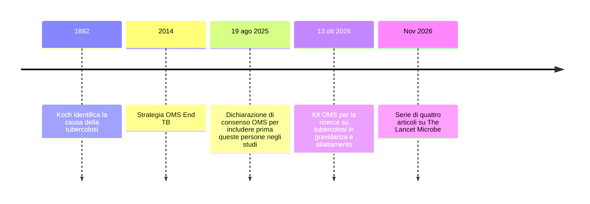
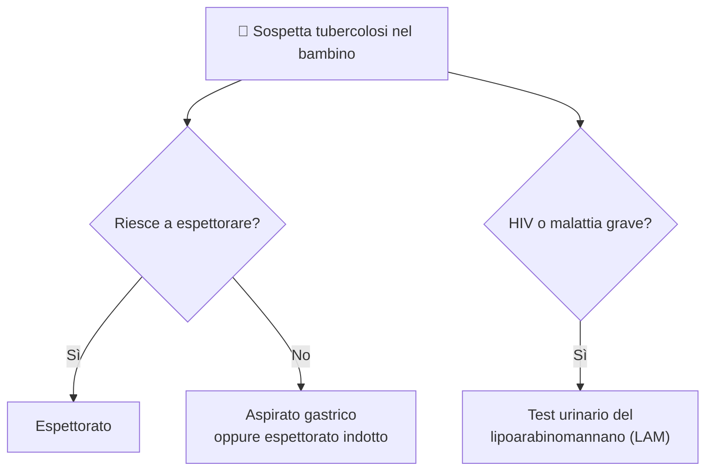

# Tubercolosi: donne in gravidanza, bambini e adolescenti

> Scheda di lettura dell'editoriale «No end to tuberculosis without women and children», *The Lancet Microbe*, vol. 7, novembre 2026, 101587. doi:10.1016/j.lanmic.2026.101587. Sintesi con parole proprie, per studio; non è una voce dell'Atlante e non è stata controllata dal revisore clinico.

---

## 📌 Messaggio principale

L'editoriale presenta una serie di quattro articoli su epidemiologia, diagnosi, terapia e prevenzione della tubercolosi. La tesi è semplice: la ricerca avanza, ma **donne in gravidanza o allattamento, bambini e adolescenti** ne beneficiano per ultimi, perché sono stati esclusi dagli studi e mancano strumenti adatti a loro.

---

## 📊 I numeri citati

| Dato (stime annue riportate dall'editoriale) | Valore |
| --- | --- |
| Morti per tubercolosi nel mondo | 1,23 milioni |
| Donne in gravidanza o nel post-partum che si ammalano | 336 900 |
| Bambini sotto i 15 anni che si ammalano | 1,1 milioni |
| Morti tra i bambini | 170 000–200 000 |
| Mortalità quando Koch scoprì il batterio (1882), Europa e USA | 1 persona su 7 |

---

## 🗓️ Le tappe



---

## 🧩 Dove si perdono le persone

```mermaid
mindmap
  accTitle: Barriere per gruppo di persone
  accDescr: Le barriere descritte nell'editoriale per adolescenti, bambini e donne in gravidanza o allattamento, e le risposte proposte.
  root((Tubercolosi: chi resta indietro))
    Adolescenti e giovani adulti
      Molti contatti sociali e spostamenti
      Diagnosi spesso tardiva
      Proposta: screening che li includa
    Bambini
      Sottodiagnosi
      Mancano formulazioni pediatriche
      Pochi operatori pediatrici
      Proposta: ricerca attiva dei casi
    Gravidanza e allattamento
      Esclusione da studi su farmaci e vaccini
      Esiti peggiori per madre e neonato
      BPaLM di 6 mesi non raccomandato in gravidanza
      Proposta: includerle negli studi fin dall'inizio
```

---

## 🔬 Come cercare la tubercolosi nel bambino

Molti bambini non riescono a espettorare. L'editoriale cita tre vie per ottenere un campione o una prova.



---

## 🩺 Che cosa interessa all'infermiere

| Tema | Perché conta |
| --- | --- |
| Gravidanza e post-partum | La tubercolosi peggiora gli esiti per la madre e per il neonato: complicanze del parto, morbilità e mortalità perinatale |
| Farmaci per forme resistenti | Il regime BPaLM di 6 mesi non è raccomandato in gravidanza perché i dati di sicurezza sono scarsi |
| Bambini | Servono campioni alternativi all'espettorato e farmaci in forma adatta all'età |
| Adolescenti | Sono un gruppo chiave per la trasmissione e vengono diagnosticati tardi |
| Ricerca | Senza studi che includano questi gruppi mancano dati su schemi, dosi e sicurezza |

---

## ⚠️ Limiti della fonte

- È un editoriale di una pagina: riassume una serie di articoli, non riporta dati originali né metodi.
- I numeri sono stime globali citate senza la fonte primaria nel testo. Per usarli nell'Atlante vanno controllati sul Global Tuberculosis Report dell'OMS.
- Il BPaLM è indicato solo come «non raccomandato in gravidanza»; composizione e indicazioni vanno lette nelle linee guida OMS.
